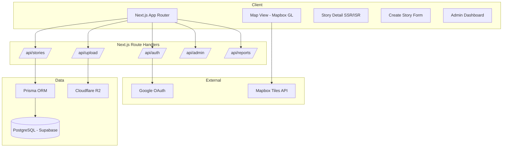

# แผนที่เรื่องเล่าของประเทศไทย (Thailand Story Map)

แพลตฟอร์มรวบรวมเรื่องเล่าทุกประเภทของประเทศไทย ผูกทุกเรื่องกับพิกัดบนแผนที่ — ให้ผู้ใช้ “เดินทางผ่านเรื่องเล่า” ได้

เอกสารนี้รวม **คู่มือพัฒนา** และ **แผนงาน MVP** ไว้ในไฟล์เดียว

---

## สารบัญ

| ส่วน | หัวข้อ |
|------|--------|
| A | [เริ่มต้นพัฒนา](#a-เริ่มต้นพัฒนา) |
| B | [สถานะและ Roadmap](#b-สถานะและ-roadmap) |
| C | [ผลิตภัณฑ์และผู้ใช้](#c-ผลิตภัณฑ์และผู้ใช้) |
| D | [เทคโนโลยีและสถาปัตยกรรม](#d-เทคโนโลยีและสถาปัตยกรรม) |
| E | [โมเดลข้อมูล](#e-โมเดลข้อมูล) |
| F | [หน้าจอและฟีเจอร์หลัก](#f-หน้าจอและฟีเจอร์หลัก) |
| G | [เนื้อหา SEO ความปลอดภัย](#g-เนื้อหา-seo-ความปลอดภัย) |
| H | [ขอบเขต KPI ความเสี่ยง หลัง MVP](#h-ขอบเขต-kpi-ความเสี่ยง-หลัง-mvp) |

---

## A. เริ่มต้นพัฒนา

### A.1 ความต้องการของระบบ

- Node.js 20+
- npm

### A.2 ติดตั้งและรัน

```bash
npm install
npm run dev
```

เปิด [http://localhost:3000](http://localhost:3000)

| คำสั่ง | การใช้งาน |
|--------|-----------|
| `npm run dev` | พัฒนา local |
| `npm run build` | build production |
| `npm run start` | รัน production build |
| `npm run lint` | ESLint |

### A.3 ตัวแปรสภาพแวดล้อม

สร้างไฟล์ `.env` ที่ root (อย่า commit):

| ตัวแปร | บังคับ | คำอธิบาย |
|--------|--------|----------|
| `NEXT_PUBLIC_APP_URL` | แนะนำ | URL หลักของแอป (metadata, OG) |
| `NEXT_PUBLIC_API_URL` | ไม่บังคับ | ว่าง = เรียก same-origin `/api/*`; ตั้งค่าเมื่อแยก API domain |
| `NEXT_PUBLIC_BASE_PATH` | ถ้า deploy ใต้ subpath | prefix path สำหรับ asset/link |
| `NEXT_PUBLIC_SUPABASE_PUBLISHABLE_KEY` | Phase 1+ | Publishable key (`sb_publishable_...`) — ใช้ใน browser ได้ |
| `NEXT_PUBLIC_SUPABASE_URL` | Phase 1+ | `https://<ref>.supabase.co` |
| `SUPABASE_PROJECT_REF` | Phase 1+ | Reference ID (ตั้งค่าแล้วรัน `npm run supabase:env`) |
| `SUPABASE_DB_PASSWORD` | Phase 1+ | รหัสผ่าน Database (เก็บใน `.env` เท่านั้น) |
| `DATABASE_URL` / `DIRECT_URL` | Phase 1+ | Prisma → Supabase Postgres (pooler + direct) |
| `SUPABASE_SECRET_KEY` | แนะนำ | `sb_secret_...` ฝั่ง server เท่านั้น (Storage/admin) |

**ตั้งค่า Supabase + Prisma**

```bash
cp .env.example .env
# ใส่ publishable key, SUPABASE_DB_PASSWORD, SUPABASE_PROJECT_REF ใน .env
npm run supabase:env          # copy 3 บรรทัดที่ได้ลง .env
npm run db:push               # สร้างตารางครั้งแรก
npm run db:seed               # หมวด 5 + จังหวัดนำร่อง 4
curl http://localhost:3000/api/health
```

**แพ็กเกจ MVP ที่ติดตั้งแล้ว:** shadcn/ui, Mapbox GL, NextAuth + Prisma adapter, Tiptap, AWS SDK (R2), Upstash ratelimit, browser-image-compression.

```bash
npm run typecheck   # ตรวจ TypeScript
npm run format      # Prettier
```

### A.4 โครงสร้างโปรเจกต์ (3 ชั้น: front · api · models)

```
prisma/
└── schema.prisma          # 9 ตารางตามแผน (User, Story, Report, …)

src/
├── app/                   # Next.js routes เท่านั้น (บาง)
│   ├── api/               # Route Handlers → เรียก src/api/*
│   ├── page.tsx           # Home + แผนที่
│   ├── create/            # สร้างเรื่อง
│   ├── admin/             # แดชบอร์ด
│   ├── story/[province]/[slug]/
│   └── province/[slug]/
│
├── front/                 # UI + client
│   ├── components/        # layout, share, map, (story, admin ใน Phase 3)
│   ├── providers/         # React Query
│   ├── services/          # *.client.ts → /api/*
│   └── store/             # Zustand
│
├── api/                   # Server logic (ไม่ใช่ Route Handlers)
│   ├── db/prisma.ts
│   ├── common/            # http helpers, ApiError
│   ├── stories/           # service.ts
│   ├── upload/
│   ├── admin/
│   └── reports/
│
├── models/                # สัญญา data ร่วม front + api
│   ├── enums.ts
│   ├── schemas/           # Zod (validate ใน Route Handlers)
│   └── types/             # DTO / response types
│
├── config/                # site, supabase-env
├── lib/
│   └── supabase/          # browser / server / admin clients
├── middleware.ts          # refresh Supabase session cookie
└── utils/
```

**กติกา:** `app/api/*/route.ts` บาง → validate ด้วย `@/models/schemas` → เรียก `@/api/*/service` → ฝั่ง client เรียกผ่าน `@/front/services/*.client.ts`

---

## B. สถานะและ Roadmap

### B.1 สถานะปัจจุบัน (ณ โค้ดใน repo)

| รายการ | สถานะ |
|--------|--------|
| Next.js App Router + TypeScript + Tailwind | ✅ |
| Layout, Navbar, Footer, Modal พื้นฐาน | ✅ |
| React Query, Axios, Zustand, Zod | ✅ |
| Supabase (Postgres + JS client) | 🟡 client/middleware พร้อม; รอ `PROJECT_REF` + `db:push` |
| PostgreSQL + Prisma (9 ตาราง) | 🟡 schema + `directUrl`; รอ connection strings |
| Auth (Supabase Auth หรือ Auth.js) | ⬜ Phase 1 |
| Mapbox + clustering + filter | ⬜ Phase 2 |
| CRUD Story, R2 upload, Story detail SSR | ⬜ Phase 3 |
| Admin moderation + Report + rate limit | ⬜ Phase 4 |
| Seed content 100+ เรื่อง + SEO polish | ⬜ Phase 5 |

### B.2 Roadmap รายสัปดาห์

#### Phase 1 — Foundation (สัปดาห์ 1–2)

| สัปดาห์ | งาน |
|---------|-----|
| 1 | CI/CD (GitHub Actions → Vercel), Supabase Postgres, Prisma schema ครบ 9 ตาราง |
| 2 | Auth.js + Google OAuth, Route Handlers พื้นฐาน + error handling กลาง |

**ผลลัพธ์:** Login ใช้งานได้, DB พร้อม Phase 2

#### Phase 2 — Map (สัปดาห์ 3–4)

| สัปดาห์ | งาน |
|---------|-----|
| 3 | Mapbox GL, markers จาก DB, popup |
| 4 | Clustering, Geocoding ปักหมุด, filter หมวด/จังหวัด |

**ผลลัพธ์:** แผนที่ใช้งานได้พร้อม filter

#### Phase 3 — Story (สัปดาห์ 5–6)

| สัปดาห์ | งาน |
|---------|-----|
| 5 | ฟอร์มสร้างเรื่องหลายขั้น + Zod, อัปโหลด R2 + compress ฝั่ง client |
| 6 | Story detail SSR/ISR, SEO/OG, search เบื้องต้น (ILIKE หรือ `tsvector`) |

**ผลลัพธ์:** วงจรสร้าง–อ่านเรื่องครบ

#### Phase 4 — Moderation (สัปดาห์ 7–8)

| สัปดาห์ | งาน |
|---------|-----|
| 7 | Admin: Pending, Approve/Reject + เหตุผล, จัดการ Report |
| 8 | Rate limit (Upstash Redis), ban user, E2E + production env |

**ผลลัพธ์:** เปิด Beta ได้อย่างปลอดภัย

#### Phase 5 — Pre-launch (สัปดาห์ 9–10)

| สัปดาห์ | งาน |
|---------|-----|
| 9 | Seed อย่างน้อย 100 เรื่อง, sitemap, robots, JSON-LD |
| 10 | Lighthouse + มือถือจริง, soft launch กลุ่มเล็ก |

**ผลลัพธ์:** ไม่เปิดด้วยแผนที่ว่าง

---

## C. ผลิตภัณฑ์และผู้ใช้

### C.1 วิสัยทัศน์

สร้างแหล่งกลางเรื่องเล่าไทยที่มีโครงสร้างและพิกัด — เรื่องลี้ลับ ประวัติศาสตร์ ตำนาน คดี (มีอ้างอิง) และเรื่องท้องถิ่น

### C.2 หมวดหมู่เนื้อหา

| หมวด | คำอธิบาย | ตัวอย่าง |
|------|----------|----------|
| 👻 เรื่องลี้ลับ | ผี สถานที่หลอน | บ้านผีสิงเชียงใหม่ |
| 🏛 ประวัติศาสตร์ | เหตุการณ์ สถานที่ | สมรภูมิ, วัดเก่า |
| 📖 ตำนานพื้นบ้าน | ความเชื่อท้องถิ่น | ตำนานเจ้าแม่ |
| 🔪 คดีอาชญากรรม | มีแหล่งอ้างอิงบังคับ | ข่าว/เอกสาร |
| 🧭 เรื่องเล่าท้องถิ่น | ชุมชน ประเพณี | วิถีชีวิต |

### C.3 กลุ่มเป้าหมาย

- นักท่องเที่ยวเชิงวัฒนธรรม / สายมู
- คนรักเรื่องลี้ลับ (แชร์ง่าย engagement สูง)
- นักเขียน นักวิจัยท้องถิ่น ครูประวัติศาสตร์
- ครีเอเตอร์ที่ต้องการวัตถุดิบมีพิกัด

### C.4 จุดต่างจากคู่แข่งทางอ้อม

- Google Maps reviews, เพจ Facebook, Pantip — **ไม่มีเรื่องเล่า + แผนที่แบบมี schema**
- UGC + moderation ขยายเนื้อหาได้เร็วแต่คุมคุณภาพ
- URL และ metadata รองรับ SEO long-tail (เช่น ผี + สถานที่ + จังหวัด)

---

## D. เทคโนโลยีและสถาปัตยกรรม

### D.1 Stack — ติดตั้งแล้ว vs แผน MVP

| เลเยอร์ | เทคโนโลยี | สถานะ | เหตุผล |
|---------|-----------|--------|--------|
| Framework | Next.js 16 (App Router) | ✅ | SSR/ISR, RSC |
| UI | React 19, Tailwind CSS 4 | ✅ | พัฒนาเร็ว |
| ฟอร์ม / validation | react-hook-form, Zod | ✅ | type-safe forms |
| Client state / fetch | Zustand, TanStack Query, Axios | ✅ | pattern ใน template |
| UI kit | shadcn/ui | ✅ | `src/components/ui/*` |
| แผนที่ | Mapbox GL JS | 🟡 | ติดตั้งแล้ว — รอ `NEXT_PUBLIC_MAPBOX_TOKEN` |
| API | Route Handlers | ✅ | `src/app/api/*` |
| DB | PostgreSQL (Supabase) | ✅ | Prisma + seed หมวด/จังหวัดนำร่อง |
| ORM | Prisma | ✅ | `db:push`, `db:seed` |
| Auth | Auth.js v5 | 🟡 | `/api/auth/*` — รอ `AUTH_SECRET` + Google |
| รูปภาพ | R2 / Supabase Storage | 🟡 | SDK พร้อม — รอ env + bucket |
| Rich text | Tiptap | ✅ | สำหรับฟอร์มสร้างเรื่อง |
| Rate limit | Upstash Redis | 🟡 | `ratelimit.ts` — รอ Upstash env |
| Hosting | Vercel | ⬜ | preview ต่อ PR |

**แนะนำก่อนเปิด public submission:** Sentry, Plausible/GA4, Upstash Redis (rate limit)

### D.2 สถาปัตยกรรม



---

## E. โมเดลข้อมูล

9 ตารางหลัก — รองรับ moderation, SEO, รายงานเนื้อหา, และจังหวัดเป็น entity

### User

```
id            uuid PK
name          string
email         string (unique)
image         string?
role          enum(USER, ADMIN)
status        enum(ACTIVE, BANNED)
created_at    datetime
```

### Category

```
id       uuid PK
name     string
slug     string (unique)
icon     string?
color    string?    -- สีหมุดบนแผนที่
```

### Province

```
id     uuid PK
name   string
slug   string (unique)
region string     -- ภาคเหนือ/กลาง/... filter + landing /province/[slug]
```

### Story

```
id            uuid PK
title         string
slug          string (unique)
summary       string
content       text
latitude      float
longitude     float
province_id   uuid FK -> Province
category_id   uuid FK -> Category
author_id     uuid FK -> User
status        enum(DRAFT, PENDING, APPROVED, REJECTED)
reject_reason string?
view_count    int default 0
source_url    string?       -- บังคับหมวดคดี/ประวัติศาสตร์
is_sensitive  boolean default false
created_at    datetime
updated_at    datetime
```

### StoryImage

```
id         uuid PK
story_id   uuid FK -> Story
url        string
alt_text   string?
sort_order int default 0
created_at datetime
```

### Tag + StoryTag (M:N)

```
Tag:      id, name, slug
StoryTag: story_id, tag_id
```

### Report

```
id          uuid PK
story_id    uuid FK -> Story
reporter_id uuid FK -> User (nullable)
reason      string
status      enum(OPEN, RESOLVED)
created_at  datetime
```

### AuditLog (หลัง MVP หรือ optional)

```
id, admin_id, action, target_id, note, created_at
```

**URL แนะนำ:** `/story/[province-slug]/[story-slug]`

---

## F. หน้าจอและฟีเจอร์หลัก

### F.1 Home — แผนที่ + Sidebar

- Markers + **clustering** เมื่อ zoom out
- สีหมุดตาม Category
- รายการล่าสุด / ยอดนิยม (`view_count`)
- Filter: หมวด, จังหวัด/ภาค, แท็ก; search ชื่อ/สรุป
- Empty state ชัดเจนช่วง pre-launch

### F.2 Story Detail

- Gallery, markdown/rich content, mini-map + เปิด Google Maps
- `source_url` โดดเด่นสำหรับคดี/ประวัติศาสตร์
- Related stories, ปุ่มรายงานเนื้อหา
- Meta + Open Graph

### F.3 Create Story (multi-step)

1. หมวด + แท็ก  
2. ปักหมุด (Mapbox Geocoding)  
3. title, summary, content (เช่น Tiptap)  
4. รูป (จำกัดขนาด/จำนวน, compress client)  
5. หมวดคดี/ประวัติ → บังคับ `source_url`  

หลังส่ง: สถานะ Pending; **autosave draft**

### F.4 Admin

- คิว Pending (เก่าก่อน), preview บนแผนที่
- Approve / Reject + `reject_reason`
- จัดการ Report, ban user
- สรุปตัวเลข: เรื่องทั้งหมด, รออนุมัติ, ยอดนิยม, user ใหม่

---

## G. เนื้อหา, SEO, ความปลอดภัย

### G.1 กลยุทธ์เนื้อหา

| ระยะ | เรื่องขั้นต่ำ |
|------|----------------|
| Soft launch | 100 |
| เปิดกว้าง | 200–500 |

**จังหวัดนำร่อง:** เชียงใหม่ → ลำพูน → ลำปาง → น่าน

**แหล่งเนื้อหา:** แหล่งสาธารณะ (เขียนใหม่ + `source_url`), สัมภาษณ์ท้องถิ่น, contributor ช่วง invite-only, ทีม seed มาตรฐานคุณภาพ

**Guidelines สำคัญ**

- คดี: แหล่งอ้างอิงบังคับ; หลีกเลี่ยงชื่อเต็มคนที่ไม่ใช่ public figure (PDPA/หมิ่นประมาท)
- เรื่องลี้ลับ: ระบุว่เป็นคำบอกเล่า/ความเชื่อ
- ทุกเรื่อง: พิกัดตรวจสอบได้

### G.2 SEO

- `/province/[slug]`, `/category/[slug]`
- JSON-LD Article/Place, dynamic sitemap, OG image (`@vercel/og`)
- Internal link ผ่าน Related Stories

### G.3 Security & moderation

- Rate limit สร้างเรื่อง/รายงาน ต่อ user/IP
- ตรวจไฟล์อัปโหลด (ชนิด, ขนาด)
- Filter คำหยาบ/สแปมก่อน Pending
- Privacy Policy + Terms; ช่องทางขอลบเนื้อหา

---

## H. ขอบเขต, KPI, ความเสี่ยง, หลัง MVP

### H.1 ไม่ทำใน MVP

Mobile app, comment/like/follow/notification, chat, AI recommend, gamification — ไม่พิสูจน์สมมติฐาน “อ่าน/โพสต์เรื่องบนแผนที่”

### H.2 KPI 3 เดือนแรก

| เดือน | เป้าหมาย |
|-------|----------|
| 1 | Phase 1–2 เสร็จ; seed ทดสอบ ≥ 20 เรื่องใน DB |
| 2 | ≥ 100 เรื่อง; beta invite 20–30 คน |
| 3 | ≥ 200 เรื่อง; traffic organic เริ่มมี; UGC ที่ approve ≥ 20% ของทั้งหมด |

### H.3 ความเสี่ยงหลัก

| ความเสี่ยง | รับมือ |
|------------|--------|
| เนื้อหาไม่พอ | Phase 5 seed ก่อนเปิด |
| หมิ่นประมาท/กฎหมาย | source_url, guidelines, Report + Admin |
| Spam | Rate limit, auto-filter, ban |
| ต้นทุน Mapbox/R2 | budget alert, compress + cache |
| ทีมไม่ทัน roadmap | ปรับ scope ได้ แต่ **ไม่ตัด Phase 4** |

### H.4 หลัง MVP (เดือน 4–6)

Public submission เต็มรูปแบบ, search ดีขึ้น (`tsvector`/Meilisearch), like แบบจำกัด, partnership ท้องถิ่น, ประเมิน sponsored pin / affiliate

---

## อ้างอิงด่วนสำหรับนักพัฒนา

| งานถัดไป (Phase 1) | ไฟล์/โฟลเดอร์ที่เกี่ยวข้อง |
|--------------------|-----------------------------|
| เชื่อม Supabase + migrate | `.env`, `npm run supabase:env`, `npm run db:push` |
| Auth.js | `src/app/api/auth/[...nextauth]/`, แทน header dev `x-dev-user-id` |
| Mapbox | `src/front/components/map/` |
| ฟอร์มสร้างเรื่อง | `src/front/components/story/` + `storiesClient.create` |

เมื่อเริ่ม Phase 1 ควรอัปเดตตาราง **B.1 สถานะปัจจุบัน** ใน README ให้ตรงกับ repo ทุกครั้งที่ merge milestone สำคัญ
